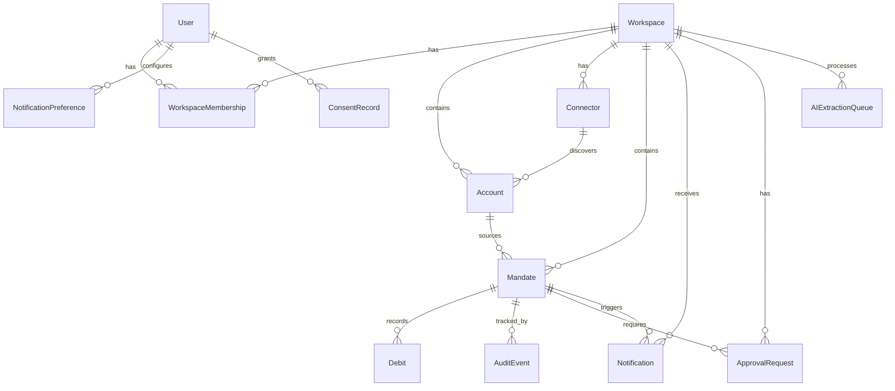

# Autopay Manager — Specification

## Stack (three bullets)

- **Next.js 14 (App Router) + TypeScript + Tailwind + shadcn/ui** — full-stack in one repo, RSC for data-heavy views, API routes for background triggers, deployed to Vercel/Railway/Fly with zero config delta.
- **Postgres (Drizzle ORM) + BullMQ (Redis)** — Drizzle gives typed schema-as-code with integer money columns and tenant-scoped queries baked into every helper; BullMQ handles connector syncs, notification dispatch, and AI pipelines as durable background jobs with retry/backoff.
- **Claude API (structured output, haiku-first) + deterministic fallback rules** — all AI calls return Zod-validated JSON; if the model is unavailable or confidence is below threshold, a rule-based fallback runs the same interface. No Python layer needed — TypeScript handles detection, clustering, and forecasting with simple stats; Claude handles NL parsing and advice.

---

## Domain Model

### Core Entities

```
User
  id, email, name, passwordHash, createdAt, updatedAt

Workspace
  id, name, type (personal | business), createdAt
  
WorkspaceMembership
  userId, workspaceId, role (owner | approver | viewer)

Account (bank/card/wallet)
  id, workspaceId, label, type (savings | current | credit_card | wallet)
  lastFour, institutionName, connectorId?, balanceMinorUnits, currency (INR)
  lastSyncedAt, createdAt

Connector
  id, workspaceId, type (account_aggregator | gmail | sms | statement_upload | manual)
  status (connected | syncing | error | disconnected)
  lastSyncAt, lastError, consentId?, consentExpiresAt?
  configEncrypted (JSON — tokens, OAuth refresh, etc.)

Mandate (the central entity)
  id, workspaceId, accountId
  merchantRaw, merchantCanonical, merchantCategory
  amountMinorUnits, amountType (fixed | variable), currency
  cadence (monthly | quarterly | yearly | weekly | custom)
  cadenceCron (for custom)
  railType (upi_autopay | nach | emandate | card_recurring | other)
  mandateExternalId?
  startDate, endDate?, nextDebitDate
  status → see state machine below
  maxAmountMinorUnits? (RBI mandate cap)
  provenanceSource (connector type + sync ID)
  createdAt, updatedAt

Debit (historical record of each execution)
  id, mandateId, workspaceId
  amountMinorUnits, currency
  debitDate, status (success | failed | pending | reversed)
  transactionRef, rawDescription
  createdAt

AuditEvent (append-only)
  id, workspaceId, entityType, entityId
  action, actorId, actorType (user | system | ai_suggestion)
  beforeSnapshot (JSONB), afterSnapshot (JSONB)
  ipAddress?, userAgent?
  createdAt

Notification
  id, workspaceId, userId
  eventType, channel (in_app | email | web_push | whatsapp | calendar)
  mandateId?, payload (JSONB)
  scheduledAt, sentAt?, status (pending | sent | failed | suppressed)
  dedupeKey (ensures never-spam-twice)

NotificationPreference
  userId, workspaceId, eventType
  channels (JSON array), leadTimeDays?, digestMode (immediate | daily_digest)
  quietStartHour?, quietEndHour?

ApprovalRequest (business mode)
  id, workspaceId, mandateId
  requestedById, action (pause | cancel | create | modify)
  status (pending | approved | rejected | expired)
  approvedById?, thresholdMinorUnits?
  createdAt, resolvedAt?

AIExtractionQueue
  id, workspaceId, source (email | sms | statement)
  rawContent, extractedData (JSONB)?
  confidence, status (pending | accepted | rejected | needs_review)
  mandateId? (linked after acceptance)
  createdAt

ConsentRecord (compliance)
  id, workspaceId, userId
  purpose, scope, consentGivenAt, expiresAt, revokedAt?
  dataRetentionDays
```

### Mandate State Machine

```
           ┌──────────┐
     ┌────►│ detected  │ (AI/connector found it, not yet confirmed by user)
     │     └─────┬─────┘
     │           │ user confirms
     │     ┌─────▼─────┐
     │     │  active    │◄──── resume
     │     └─────┬─────┘
     │           │
     │     ┌─────┴──────────┐
     │     │                │
     │  ┌──▼───┐      ┌────▼────┐
     │  │paused │      │cancelled│
     │  └──────┘      └─────────┘
     │
     │  ┌──────────┐
     └──│ manual   │ (user-created, skips detection)
        └─────┬────┘
              │ activate
              ▼
           active
```

Valid transitions:
- `detected → active` (user confirms)
- `detected → cancelled` (user dismisses)
- `active → paused` (one-click, low risk)
- `active → cancelled` (one-click, low risk)
- `paused → active` (resume, one-click)
- `paused → cancelled`
- `manual → active`

**No transition that initiates a debit exists in this system.** Mandates are tracked/controlled, not originated. If we add mandate creation on a payment rail, it requires typed confirmation per §6.

---

## Cashflow Forecast

- Sum projected balance = current balance − Σ(upcoming debits in window) + Σ(known inflows if available)
- Each mandate contributes its next N occurrences based on cadence + nextDebitDate
- Variable-amount mandates use trailing 3-month average
- Shortfall dates highlighted when projected balance < 0 or < user-defined threshold
- 90-day default window, user-adjustable

## Subscription Killer Scoring

Ranked by `savings_per_regret`:
- `savingsMonthly = amountMinorUnits * frequency_per_month`
- `regretScore` = recency of last usage signal (email open, login, transaction pattern) — high usage = high regret risk
- `savingsPerRegret = savingsMonthly / regretScore`

Flags: unused (no usage signal > 90 days), price hike (current > historical avg + 10%), duplicate (same category, multiple active), trial-to-paid (detected free→paid transition)

## Business Approval Workflow

1. Action requested on mandate where `amountMinorUnits > workspace.approvalThreshold`
2. ApprovalRequest created, assigned to users with `approver` role
3. Notification sent to approvers
4. Approver approves/rejects with optional note
5. On approval, original action executes
6. All steps logged to AuditEvent

## Compliance Hooks

- **RBI pre-debit notification**: system sends notification ≥24h before any detected upcoming debit
- **Mandate amount cap**: alerts if debit exceeds `maxAmountMinorUnits`
- **AA consent lifecycle**: consent records with TTL, auto-revocation, re-consent flow
- **DPDP Act**: purpose-limited data collection, retention windows, export-and-delete endpoint (`/api/user/data-export`, `/api/user/data-delete`)
- **Secrets**: all tokens/OAuth credentials encrypted with AES-256-GCM at rest via a `encrypt()`/`decrypt()` utility; never logged, never in client bundles
- **Account numbers**: only `lastFour` stored; full numbers never persisted

## Security

- Auth: NextAuth.js with email/password + OAuth (Google), bcrypt passwords, httpOnly secure cookies
- Tenant isolation: every DB query helper takes `workspaceId` as required param; RLS policies as defense-in-depth
- CSRF: Next.js built-in
- Rate limiting on auth endpoints
- Input validation: Zod on every API boundary

---

## Entity Diagram (Mermaid)


